# Capturas de las pruebas

Cada imagen es una hoja de capturas: columnas = momentos de la animación; fila de arriba = vista 3/4 frontal; fila de abajo = vista lateral (el modelo mira a la derecha).
Colores: azul tronco, amarillo cabeza y brazos, verde piernas/patas, morado cola, rojo alas. La marca negra es la cara.

Son las **plantillas** (sin IA). Se regeneran con `node tools/capture.mjs docs/capturas` (con el servidor arrancado).

## R15

**Caminar**

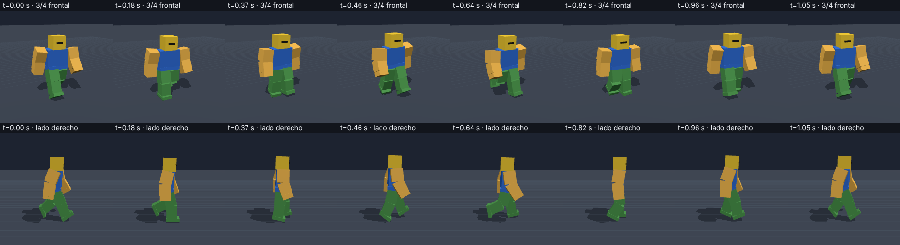

**Atacar**

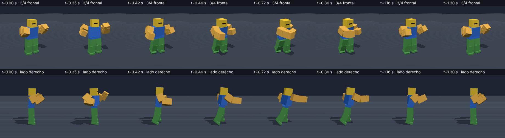

**Correr**

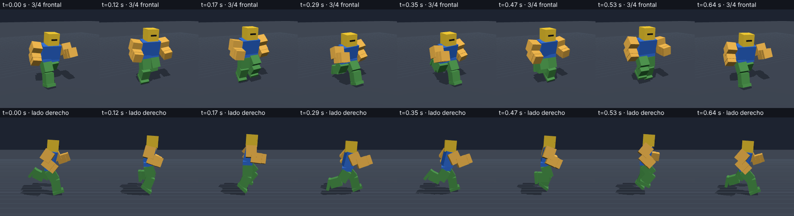

**Saltar**

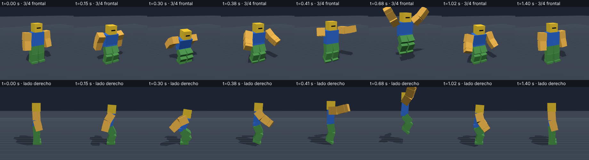

**Saludar**

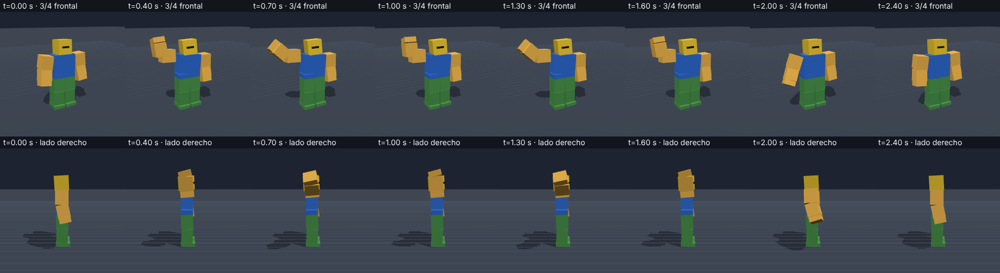

**Reposo**

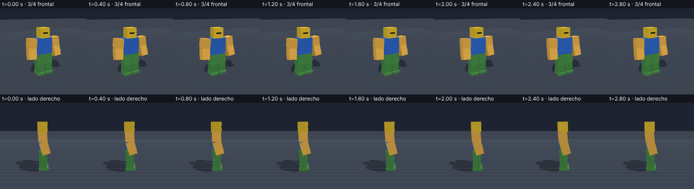

## R6

**Caminar**

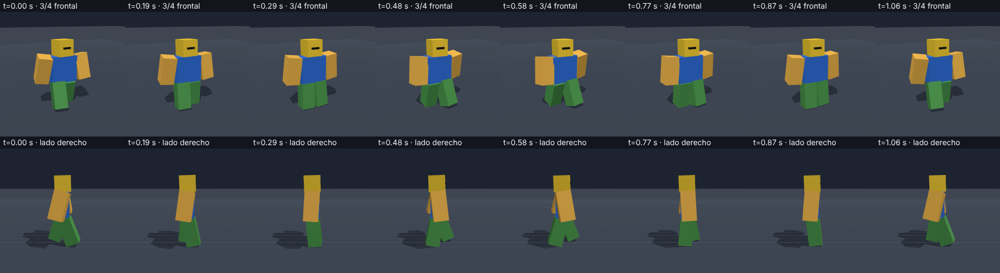

**Atacar**

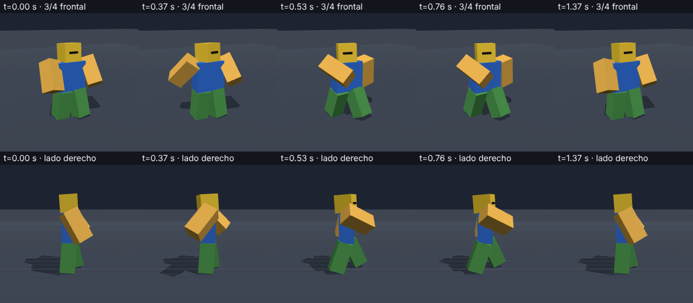

## Yeti (bípedo grande, nombres en castellano)

**Caminar**

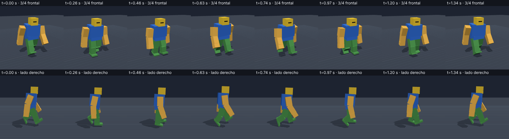

**Atacar**

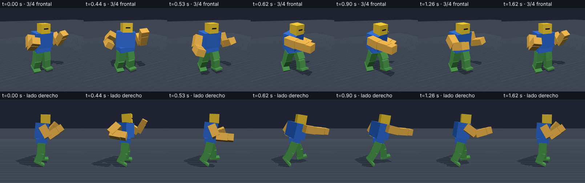

## Lobo (cuadrúpedo con huesos)

**Caminar**

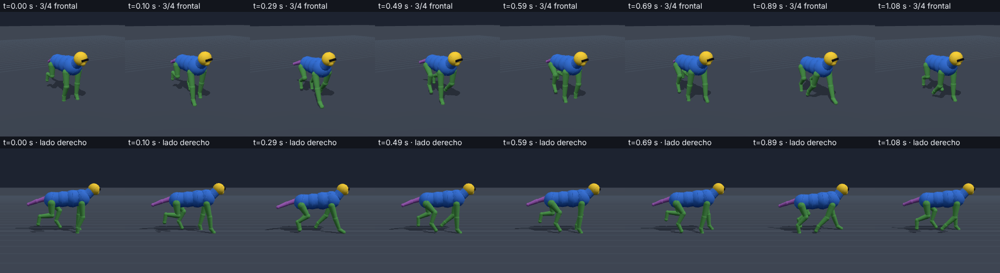

**Atacar (mordisco)**

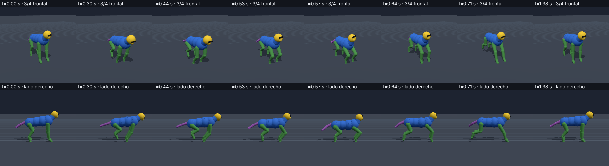

**Correr (trote)**

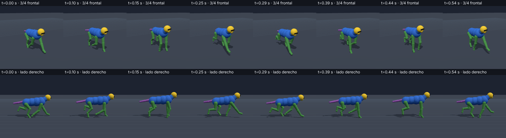

**Saltar**

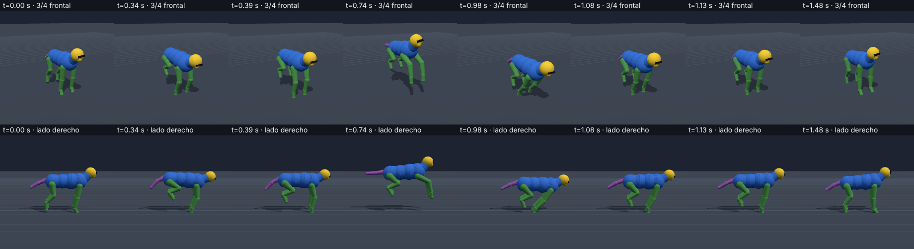

**Saludar (levanta la pata)**

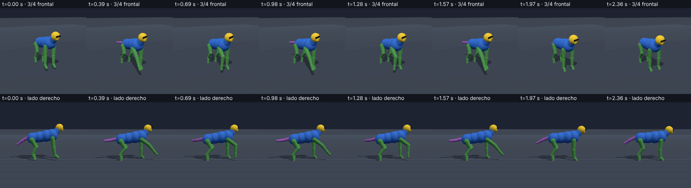

**Reposo**

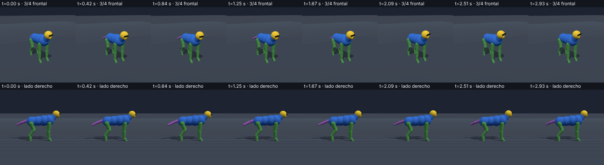

## Dragón (alas y cola, alas con nombres genéricos)

**Caminar**

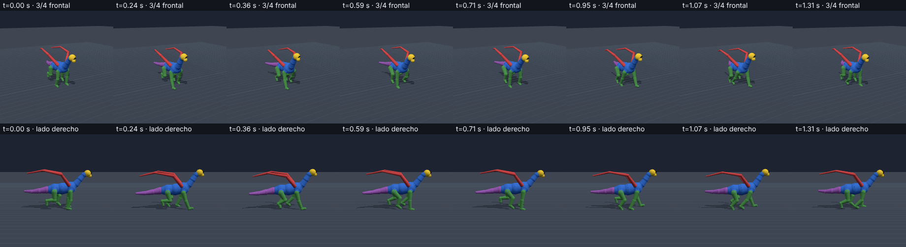

**Atacar**

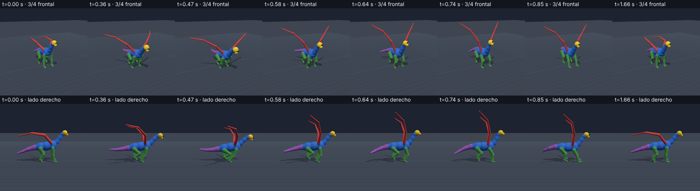

**Saltar**

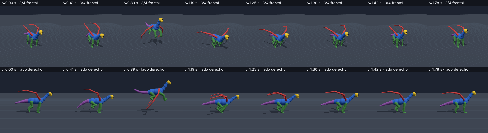

**Correr**

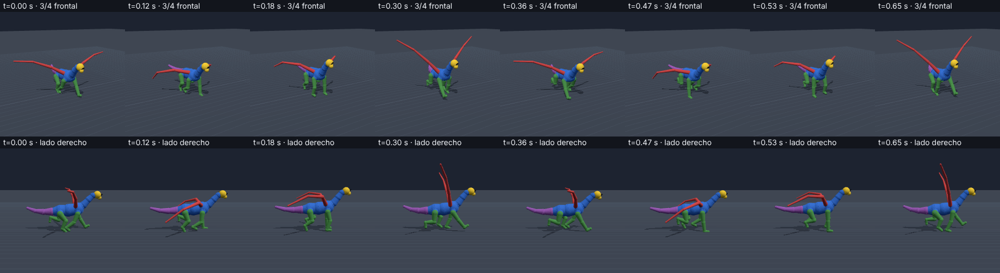

## Puerta con bisagra

**Abrir y cerrar**

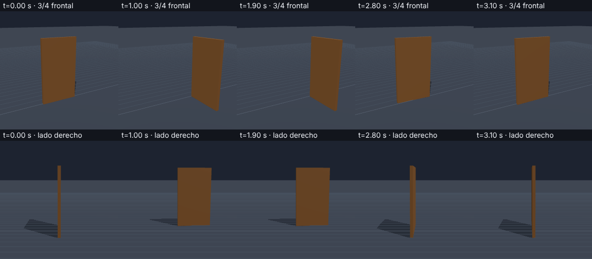
